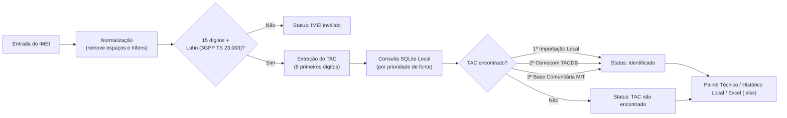

<div align="center">


# IMEI CHECK

**Sistema corporativo local, 100% gratuito e offline para validação de IMEIs e identificação de dispositivos por código TAC (*Type Allocation Code*).**

Desenvolvido para operações de **telemetria, rastreamento veicular, IoT e chips M2M** — substituindo sites públicos cheios de anúncios e pop-ups por uma ferramenta interna segura, auditável e instantânea.


</div>

---

## 🎯 Contexto e Problema Resolvido

Em rotinas de suporte e ativação de chips M2M e rastreadores, equipes costumam recorrer a sites externos (como o `IMEI.info`) para descobrir fabricante e modelo de um equipamento — enfrentando excesso de anúncios, redirecionamentos, pop-ups de vídeo e riscos de exposição de dados operacionais.

O **IMEI CHECK** elimina essa dependência:

- **Zero custo operacional:** sem APIs pagas, sem créditos por consulta, sem assinaturas e sem períodos de teste.
- **Zero anúncios e zero scraping:** consome exclusivamente bases públicas oficiais e abertas.
- **Privacidade total:** nenhum IMEI consultado ou histórico sai do computador da empresa.
- **Funcionamento offline:** após o download inicial da base, todas as consultas executam em milissegundos contra o banco SQLite local (`database/imei_database.db`).

---

## ⚙️ Arquitetura e Fluxo de Identificação



---

## 🚀 Funcionalidades Principais

| Módulo | O que oferece |
|---|---|
| **Início (Dashboard)** | Métricas de total de consultas, identificados, não encontrados, inválidos, data da última atualização da base, atalhos rápidos e consultas recentes. |
| **Consultar IMEI** | Validação estrutural (15 dígitos), cálculo do dígito verificador pelo **algoritmo de Luhn**, decomposição técnica (`TAC`, `SNR`, `Dígito Verificador`), nomes alternativos (`AKA`) e referência catalogada. |
| **Consulta em lote** | Análise simultânea de até **10 IMEIs** colados por linha, resumo numérico, tabela colorida por status e download imediato em **Excel (`.xlsx`)**. |
| **Histórico local** | Armazenamento local em SQLite com filtro por status e texto, exportação `.xlsx`, chave para **ativar/desativar gravação** e exclusão confirmada em duas etapas. |
| **Banco de dados** | Atualização segura das bases gratuitas, importação de **CSV interno da empresa** (para rastreadores/fornecedores próprios) e explorador de catálogo offline por TAC, marca ou modelo. |
| **Sobre o sistema** | Transparência técnica sobre algoritmo de Luhn, licenças das bases, garantias de privacidade e limitações da consulta TAC. |

### Status padronizados de retorno

- **`Identificado`** — IMEI válido e TAC localizado na base offline (exibe fabricante, modelo quando informado e fonte).
- **`TAC não encontrado`** — IMEI estruturalmente válido pelo algoritmo de Luhn, porém sem registro para o TAC na base local.
- **`IMEI inválido`** — Quantidade incorreta de dígitos, caracteres não numéricos ou falha no dígito verificador de Luhn.
- **`Erro na consulta`** — Falha inesperada de leitura no banco local tratada com segurança.

---

## 🛡️ Diferenciais de Engenharia e Confiabilidade

- **Atualização atômica à prova de falhas:** os downloads passam primeiro por arquivo temporário, verificação de assinatura binária (`SQLite format 3\x00`), limite máximo de 100 MB, abertura somente leitura (`?mode=ro`) e validação de esquema/contagem mínima antes de entrar em transação `BEGIN IMMEDIATE`. Se a rede falhar ou o arquivo estiver corrompido, **a base válida anterior é preservada intacta**.
- **Tratamento de anomalias reais das bases:** remove espaços à esquerda e duplicidades presentes no dump oficial do Osmocom (ex.: `' 35572302'`) e aplica *zero-padding* seguro em TACs legados de 6 e 7 dígitos na base complementar, descartando linhas de cabeçalho inválidas.
- **Prioridade de fontes sem sobrescrita destrutiva:** os registros convivem por chave composta `(tac, origem)`, garantindo que listas internas da empresa (`Importação Local`) tenham prioridade `1`, seguidas pelo `Osmocom TAC Database` (`2`) e pela `Base Comunitária` (`3`). Atualizar uma fonte nunca apaga as demais.
- **Exportação Excel (`.xlsx`) pronta para operação:** gera planilhas com cabeçalho estilizado, filtro automático, painel congelado (`A2`), largura automática de colunas, destaque visual na coluna `Status` e células de IMEI/TAC formatadas como texto (`@`) para impedir notação científica (`3,56E+14`) ou perda de zeros à esquerda.
- **Prevenção contra HTML Injection:** todos os valores exibidos em cartões HTML passam por `html.escape()`.

---

## 📚 Fontes de Dados Gratuitas e Licenças

| Fonte | Papel | Endpoint Oficial | Licença | Cobertura |
|---|---|---|---|---|
| **Osmocom TAC Database** | Fonte Principal | `http://tacdb.osmocom.org/export/tacdb.sqlite3`<br>*(fallback: `/export/tacdb.csv`)* | **CC-BY-SA v3.0 Unported** | **22.524** TACs normalizados (`brand`, `model`, `aka`, `contributor`, `gsmarena`, `date`) |
| **Base Comunitária (MoazEb/tac-database)** | Complementar Opcional | `https://raw.githubusercontent.com/MoazEb/tac-database/main/tac_full.csv` | **MIT License** | Amplia para **275.847** TACs únicos (inclui Optus V36 e módulos/rastreadores como Teltonika, Queclink, Suntech, Maxtrack, Quectel, u-blox, Concox, Telit e Simcom) |
| **Importação Local (CSV)** | Prioridade Máxima | Upload local na aba *Banco de dados* | Uso interno | Planilhas internas de fornecedores e equipamentos homologados pela empresa |

---

## 💻 Instalação e Execução (Windows 10 e Windows 11)

### 1. Instalação automática (primeira vez)

1. Certifique-se de ter **Python 3.11 ou superior** instalado no Windows.
2. Dê um duplo clique em **`instalar.bat`**.
3. O instalador localiza automaticamente o executável real do Python (ignorando o atalho da Microsoft Store em `WindowsApps`), cria o ambiente virtual `.venv`, instala as dependências de `requirements.txt` e executa `services.bootstrap --with-community` para baixar a base offline.

### 2. Execução diária

1. Dê um duplo clique em **`iniciar.bat`**.
2. O sistema abre automaticamente no navegador em `http://localhost:8501` (com `showEmailPrompt = false` e `gatherUsageStats = false` já configurados em `.streamlit/config.toml`).
3. Para encerrar, feche a janela do terminal ou pressione `Ctrl+C`.

### 3. Comandos úteis via terminal

```bat
:: Iniciar a interface Streamlit manualmente
.venv\Scripts\python.exe -m streamlit run app.py

:: Atualizar as bases TAC via linha de comando
.venv\Scripts\python.exe -m services.bootstrap --with-community

:: Executar toda a suíte de testes automatizados
.venv\Scripts\python.exe -m pytest -v
```

### Formato aceito para CSV interno da empresa

```csv
tac,fabricante,modelo,detalhes
35699357,Teltonika,RUT956,Roteador industrial LTE/M2M
```

---

## 🗂️ Estrutura do Projeto

```text
IMEI-CHECK/
├── .streamlit/
│   └── config.toml                 # Tema escuro, privacidade e supressão de prompt inicial
├── app.py                          # Ponto de entrada e roteamento Streamlit
├── requirements.txt                # Dependências 100% gratuitas
├── instalar.bat                    # Preparação automática de .venv, pacotes e base offline
├── iniciar.bat                     # Inicialização em 1 clique no Windows 10/11
├── assets/
│   └── logo.png                    # Ícone oficial do sistema
├── database/
│   ├── .gitkeep
│   └── imei_database.db            # Banco SQLite local (gerado na instalação/atualização)
├── services/
│   ├── imei_validator.py           # Normalização, 15 dígitos, Luhn e extração de TAC
│   ├── database_service.py         # Persistência SQLite, histórico, métricas e transações
│   ├── tac_service.py              # Consulta individual/lote e importadores seguros
│   ├── export_service.py           # Geração de planilhas Excel (.xlsx) formatadas
│   └── bootstrap.py                # CLI para inicialização e download inicial das bases
├── components/
│   ├── styles.py                   # CSS customizado e paleta de status
│   ├── sidebar.py                  # Menu lateral e indicador de estado offline
│   ├── dashboard.py                # Painel inicial com métricas e atalhos
│   ├── search.py                   # Tela de consulta individual
│   ├── batch_search.py             # Tela de consulta em lote (até 10 IMEIs)
│   ├── history.py                  # Histórico local, controle de privacidade e exclusão
│   ├── database_manager.py         # Atualização de fontes, CSV interno e busca no catálogo
│   └── about.py                    # Documentação técnica e transparência de dados
└── tests/
    ├── test_imei_validator.py      # Validação, Luhn, TAC e limites de lote
    ├── test_database_service.py    # Histórico, toggle de privacidade, métricas e busca
    ├── test_tac_service.py         # Offline, lote, parsers, falhas e auditoria zero-API-paga
    ├── test_export_service.py      # Estrutura, cabeçalhos e formato texto no XLSX
    └── test_ui_app.py              # Testes integrados da interface Streamlit (AppTest)
```

---

## 🧪 Qualidade e Testes Automatizados

A suíte com **22 testes automatizados** (`pytest`) valida toda a regra de negócio e interface de ponta a ponta:

- Validação de 15 dígitos, algoritmo de Luhn e extração do TAC;
- Consulta offline (bloqueando `requests.get`) para TAC existente, TAC inexistente e IMEI inválido;
- Consulta em lote com limite máximo de 10 IMEIs;
- Parsers reais para `tacdb.sqlite3`, `tacdb.csv`, CSV comunitário e CSV local;
- Preservação da base anterior diante de falhas simuladas de conexão/download;
- Exportação `.xlsx` verificando congelamento, cabeçalhos e preservação de zeros à esquerda;
- Navegação completa das 6 telas Streamlit e fluxos de busca via `AppTest`;
- Auditoria automática garantindo ausência de SDKs pagos, credenciais ou URLs de scraping.

---

## ⚠️ Limitações Conhecidas

- **Cobertura comercial da GSMA:** nenhuma base pública gratuita contém 100% de todas as alocações comerciais mundiais da GSMA (cuja base oficial completa é paga e restrita). Quando um rastreador muito novo ou proprietário retornar `TAC não encontrado`, recomenda-se cadastrar seu lote via CSV interno na aba **Banco de dados**.
- **Validade vs. Identificação:** um IMEI aprovado no cálculo de Luhn possui estrutura válida, mas pode não estar cadastrado na base pública.
- **Escopo estritamente TAC:** a consulta identifica apenas fabricante/modelo atribuído aos 8 primeiros dígitos. Ela **não** verifica se o dispositivo está ligado, conectado à rede celular, com chip M2M ativo ou bloqueado na operadora, e **não** inventa classificações ausentes na base de origem.
- **Uso externo para empresa**